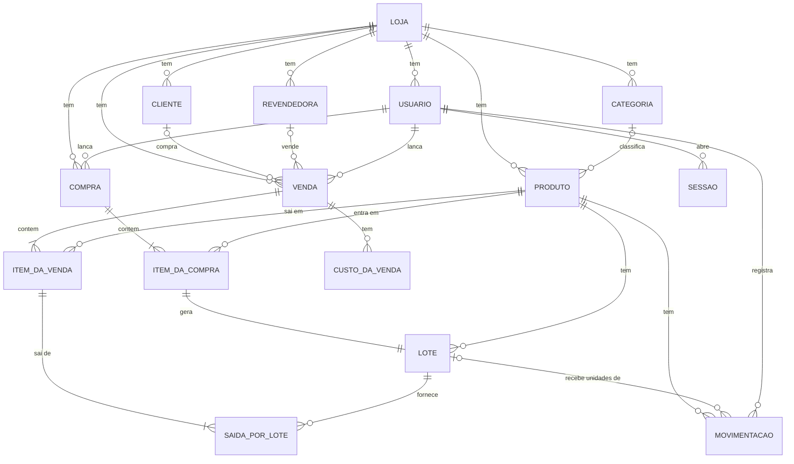

# Modelo de dados

Entidades do sistema, seus campos e relações, no nível de negócio. Os nomes técnicos de tabelas e colunas estão no
código (`apps/server/src/db/schema/`).

## Convenções

- Toda entidade de negócio pertence a uma loja.
- Toda entidade guarda a data de criação e a data da última alteração.
- Valores em dinheiro são guardados em centavos exatos. Percentuais vão de 0% a 100%, com até duas casas decimais.
- Validade é guardada como mês e ano.
- "Único" vale dentro da loja, salvo indicação.
- Nenhuma entidade é apagada ([regras gerais](README.md#regras-gerais)). Cadastros têm data de arquivamento ou de
  desativação; lançamentos têm data e motivo de cancelamento.

Tipos usados nas tabelas: **texto**, **inteiro**, **dinheiro**, **percentual**, **data** (dia do calendário),
**mês** (mês e ano), **data e hora**, **sim/não**, **opção** (valor de uma lista fixa) e **referência** (aponta para
outra entidade).

## Diagrama

## Acesso

### Loja

| Campo | Tipo | Obrigatório | Regras |
| --- | --- | --- | --- |
| Nome | texto | sim | Até 120 caracteres |
| Documento | texto | não | CPF ou CNPJ, como digitado, até 30 caracteres |
| Telefone | texto | não | Até 30 caracteres |
| Endereço | texto | não | Até 300 caracteres |
| Imposto padrão | percentual | sim | Começa em 0% |
| Taxa do Mercado Livre | percentual | sim | Começa em 0% |
| Antecedência de vencimento | inteiro | sim | De 1 a 365 dias. Começa em 30 |

### Usuário

| Campo | Tipo | Obrigatório | Regras |
| --- | --- | --- | --- |
| Loja | referência | sim | |
| Nome | texto | sim | Até 120 caracteres |
| E-mail | texto | sim | Único no sistema inteiro, guardado em minúsculas |
| Senha | texto | sim | Guardada só como hash, nunca em texto |
| Desativado em | data e hora | não | Preenchido quando o usuário é desativado |

### Sessão

Acesso aberto por um usuário em um aparelho.

| Campo | Tipo | Obrigatório | Regras |
| --- | --- | --- | --- |
| Usuário | referência | sim | |
| Token | texto | sim | Guardado só como hash |
| Expira em | data e hora | sim | Renovado a cada uso, 30 dias à frente |
| Pela senha mestra | sim/não | sim | Indica acesso do suporte |

A sessão é a única entidade apagada: ao sair, ao trocar a senha (as dos outros aparelhos) e ao desativar o usuário.

## Catálogo

### Categoria

| Campo | Tipo | Obrigatório | Regras |
| --- | --- | --- | --- |
| Loja | referência | sim | |
| Nome | texto | sim | Até 60 caracteres. Único, sem diferenciar maiúsculas e acentos, contando as arquivadas |
| Arquivada em | data e hora | não | |

### Produto

| Campo | Tipo | Obrigatório | Regras |
| --- | --- | --- | --- |
| Loja | referência | sim | |
| Categoria | referência | não | Categoria da mesma loja |
| Nome | texto | sim | Até 120 caracteres. Pode se repetir |
| Preço base | dinheiro | sim | Maior que zero |
| Código de barras | texto | não | Único, contando os arquivados |
| Código interno | texto | não | Único sem diferenciar maiúsculas, contando os arquivados |
| Estoque mínimo | inteiro | não | De 0 a 1.000.000 |
| Localização | texto | não | Onde o produto fica na loja |
| Tem validade | sim/não | sim | Começa em "não" |
| Foto | texto | não | Endereço do arquivo da foto |
| Arquivado em | data e hora | não | |

O produto não guarda quantidade nem custo: os dois vêm dos lotes e das movimentações.

## Pessoas

### Cliente

| Campo | Tipo | Obrigatório | Regras |
| --- | --- | --- | --- |
| Loja | referência | sim | |
| Nome | texto | sim | Até 120 caracteres. Pode se repetir |
| Telefone | texto | não | Só dígitos, com DDD |
| Endereço | texto | não | Texto livre, até 300 caracteres |
| Observação | texto | não | Até 500 caracteres |
| Arquivado em | data e hora | não | |

### Revendedora

| Campo | Tipo | Obrigatório | Regras |
| --- | --- | --- | --- |
| Loja | referência | sim | |
| Nome | texto | sim | Até 120 caracteres. Pode se repetir |
| Telefone | texto | não | Só dígitos, com DDD |
| Comissão padrão | percentual | sim | |
| Observação | texto | não | Até 500 caracteres |
| Arquivada em | data e hora | não | |

## Compras

### Compra

| Campo | Tipo | Obrigatório | Regras |
| --- | --- | --- | --- |
| Loja | referência | sim | |
| Número | inteiro | sim | Sequencial e único, nunca reaproveitado |
| Data | data | sim | Não pode ser futura |
| Observação | texto | não | Até 500 caracteres |
| Usuário | referência | sim | Quem lançou |
| Cancelada em | data e hora | não | |
| Motivo do cancelamento | texto | não | |

### Item da compra

| Campo | Tipo | Obrigatório | Regras |
| --- | --- | --- | --- |
| Compra | referência | sim | |
| Produto | referência | sim | Produto ativo no lançamento |
| Posição | inteiro | sim | Ordem do item na compra |
| Quantidade | inteiro | sim | De 1 a 100.000 |
| Custo unitário | dinheiro | sim | Maior ou igual a zero |
| Validade | mês | depende | Obrigatória se o produto tem validade, recusada se não tem |

Uma compra tem de 1 a 100 itens.

## Estoque

### Lote

Unidades de um produto com a mesma origem e a mesma validade. Cada item de compra gera um lote; o ajuste para cima
também gera um lote.

| Campo | Tipo | Obrigatório | Regras |
| --- | --- | --- | --- |
| Produto | referência | sim | |
| Item da compra | referência | não | A origem, quando veio de uma compra. Um lote por item |
| Validade | mês | não | Vazia quando o produto não tem validade |
| Quantidade | inteiro | sim | Unidades que restam no lote. Nunca negativa |

### Movimentação

Registro de cada mudança de quantidade ou de custo de um produto. Nunca é alterada nem apagada.

| Campo | Tipo | Obrigatório | Regras |
| --- | --- | --- | --- |
| Sequência | inteiro | sim | Ordem das movimentações, definida na gravação |
| Produto | referência | sim | |
| Tipo | opção | sim | Compra, compra cancelada, venda, venda cancelada, ajuste ou correção de custo |
| Quantidade | inteiro | sim | Variação em unidades: positiva na entrada, negativa na saída, zero na correção de custo |
| Variação de valor | dinheiro | sim | Variação do valor em estoque, positiva ou negativa |
| Custo unitário | dinheiro | sim | Custo da entrada ou custo médio da saída |
| Quantidade depois | inteiro | sim | Quantidade em estoque logo depois da movimentação |
| Custo médio depois | dinheiro | sim | Custo médio logo depois da movimentação |
| Lote | referência | não | O lote que recebeu as unidades, em uma entrada |
| Motivo | opção | depende | Só no ajuste, e obrigatório nele: contagem, avaria, perda, vencido descartado, brinde ou uso interno, ou outro |
| Observação | texto | depende | Obrigatória no ajuste com motivo "outro" e na correção de custo. Até 500 caracteres |
| Item da compra | referência | não | Origem, quando veio de uma compra |
| Item da venda | referência | não | Origem, quando veio de uma venda |
| Usuário | referência | sim | Quem fez |

Uma movimentação tem no máximo uma origem (item da compra ou item da venda).

A quantidade em estoque de um produto é a soma das quantidades dos seus lotes. O valor em estoque é a soma das
variações de valor das suas movimentações. O custo médio é o valor dividido pela quantidade.

## Vendas

### Venda

| Campo | Tipo | Obrigatório | Regras |
| --- | --- | --- | --- |
| Loja | referência | sim | |
| Número | inteiro | sim | Sequencial e único, nunca reaproveitado |
| Data | data | sim | Não pode ser futura |
| Canal | opção | sim | Loja, Mercado Livre ou Revendedora |
| Revendedora | referência | depende | Obrigatória no canal Revendedora e vazia nos outros |
| Cliente | referência | não | |
| Condição de pagamento | opção | sim | À vista ou A prazo |
| Forma de pagamento | opção | sim | Pix, dinheiro, crédito ou débito |
| Desconto | dinheiro | sim | Maior ou igual a zero. Zero quando não há |
| Acréscimo | dinheiro | sim | Maior ou igual a zero. Zero quando não há |
| Receita | dinheiro | sim | Calculada. Maior ou igual a zero |
| Custo dos produtos | dinheiro | sim | Calculado |
| Custos da venda | dinheiro | sim | Calculado: soma dos custos da venda |
| Lucro | dinheiro | sim | Calculado: receita menos custo dos produtos menos custos da venda. Negativo é prejuízo |
| Usuário | referência | sim | Quem lançou |
| Cancelada em | data e hora | não | |
| Motivo do cancelamento | texto | depende | Obrigatório no cancelamento. Até 500 caracteres |

### Item da venda

| Campo | Tipo | Obrigatório | Regras |
| --- | --- | --- | --- |
| Venda | referência | sim | |
| Produto | referência | sim | Produto ativo no lançamento. Uma vez por venda |
| Posição | inteiro | sim | Ordem do item na venda |
| Quantidade | inteiro | sim | De 1 a 100.000 |
| Preço unitário | dinheiro | sim | Maior ou igual a zero. Zero é brinde |
| Custo unitário | dinheiro | sim | Custo médio no registro, arredondado ao centavo |
| Custo | dinheiro | sim | Valor que saiu do estoque com essas unidades |

Uma venda tem de 1 a 100 itens.

### Saída por lote

De quais lotes saíram as unidades de um item da venda. O cancelamento da venda devolve as unidades a esses lotes.

| Campo | Tipo | Obrigatório | Regras |
| --- | --- | --- | --- |
| Item da venda | referência | sim | |
| Lote | referência | sim | Um registro por lote em cada item |
| Quantidade | inteiro | sim | Maior que zero |

### Custo da venda

| Campo | Tipo | Obrigatório | Regras |
| --- | --- | --- | --- |
| Venda | referência | sim | |
| Posição | inteiro | sim | Ordem do custo na venda |
| Tipo | opção | sim | Frete, imposto, taxa de plataforma, comissão ou outro |
| Forma | opção | sim | Em reais ou em percentual |
| Valor informado | dinheiro ou percentual | sim | Em reais, maior ou igual a zero; em percentual, de 0% a 100% |
| Nome | texto | não | Nome dado pelo usuário, como "Embalagem" |
| Valor | dinheiro | sim | O valor em reais, ou o percentual aplicado sobre a receita e arredondado ao centavo |

Uma venda tem até 20 custos.

## Auditoria

### Registro de auditoria

Gravado automaticamente a cada criação, alteração ou exclusão em qualquer entidade, exceto sessões. Nunca é alterado
nem apagado.

| Campo | Tipo | Obrigatório | Regras |
| --- | --- | --- | --- |
| Loja | referência | não | |
| Entidade | texto | sim | Qual entidade mudou |
| Registro | referência | sim | Qual registro mudou |
| Ação | opção | sim | Criação, alteração ou exclusão |
| Usuário | referência | não | Quem fez. Vazio quando foi o próprio sistema |
| Valores anteriores | texto | não | O registro antes da mudança, sem senhas |
| Valores novos | texto | não | O registro depois da mudança, sem senhas |
| Campos alterados | texto | não | Nomes dos campos que mudaram |
| Data | data e hora | sim | |
